# 1DM+ Implementation Roadmap: LID Download Manager

**Repository:** `r4m335/SwiftDownloadEngine`  
**Application:** LID Download Manager (iOS)  
**Reference Application:** Android 1DM+  
**Target Architecture:** Swift 5.10 / iOS 15.0+  
**Date:** November 2026  

---

## 1. Roadmap Strategy & Architectural Principles

Based on the **1DM+ Feature Parity Assessment** (`docs/1dm-feature-parity-assessment.md`), LID currently achieves **63.4% full parity** (45/71 features complete).

To bridge the remaining functional distance without compromising stability or violating iOS platform boundaries, subsequent development is structured into three prioritized phases:

```
┌────────────────────────────────────────────────────────────────────────┐
│                        Phased Parity Evolution                         │
├────────────────────────────────────────────────────────────────────────┤
│ Phase 3: Core UX, Browser & Media Parity (High Impact / User-Facing)   │
│   • Milestone 3.1: Interactive Stream Quality / Resolution Picker      │
│   • Milestone 3.2: WKContentRuleListStore Ad & Popup Blocker           │
│   • Milestone 3.3: Download File Categories & Subfolder Routing        │
│   • Milestone 3.4: Per-Tab Desktop Mode & Ephemeral Incognito Browsing │
├────────────────────────────────────────────────────────────────────────┤
│ Phase 4: Batch Downloads & Swarm Enhancements (Power Features)         │
│   • Milestone 4.1: Batch URL Pattern Expansion & Multi-Link Import     │
│   • Milestone 4.2: Torrent Swarm Tracker Management & Sequential Mode  │
│   • Milestone 4.3: Live Bandwidth Throughput Chart (Swift Charts)      │
│   • Milestone 4.4: Interactive List Sorting Selector (Name, Size, Date)│
├────────────────────────────────────────────────────────────────────────┤
│ Phase 5: Power-User Utilities & Advanced Ecosystem                     │
│   • Milestone 5.1: In-App Compressed Archive Extraction (ZIP/TAR)      │
│   • Milestone 5.2: Hierarchical Bookmarks & Persistent History Store   │
│   • Milestone 5.3: Download Queue Export / Import (Backup & Migration) │
│   • Milestone 5.4: Battery-Aware Execution & Low-Power Auto-Pause      │
├────────────────────────────────────────────────────────────────────────┤
│ Workstream A: LID Dedicated Media Player Subsystem                     │
│   • Full local & network media playback engine (AVPlayer / AVKit)     │
│   • VLC-style advanced controls, gestures, speeds, & aspect ratios     │
│   • Discrete audio track & multi-subtitle stream selection             │
│   • Direct HLS/DASH playback & BitTorrent sequential swarm streaming   │
│   • VLC-powered universal media decoding engine (VLCKit / libVLC)      │
├────────────────────────────────────────────────────────────────────────┤
│ Workstream B: LID Advanced Browser Modernization                       │
│   • Enhanced multi-list ad, tracker, & cryptominer blocking            │
│   • Aggressive popup, redirect loop, & frame-busting protection        │
│   • Visual tab previews & grid/stack tab management                    │
│   • Safari Reader Mode extraction & custom site permissions/cookies    │
└────────────────────────────────────────────────────────────────────────┘
```

---

## Phase 3: Core UX, Browser & Media Parity

**Goal:** Address the highest-visibility gaps in media discovery, ad blocking, and file organization.

### Milestone 3.1: Interactive Stream Quality & Resolution Picker Modal (Complete)
- **Objective:** Allow users to inspect and choose specific stream resolutions (1080p, 720p, 480p, 360p, or audio-only) before initiating HLS or DASH downloads.
- **Status:** **Complete** (Implemented in `StreamQualityPickerSheet.swift`, `StreamQualityModels.swift`, `StreamQualityInspector.swift`, and verified by `StreamQualityPickerTests.swift`).
- **Implementation Scope:**
  - Created `StreamQualityModels.swift` and `StreamQualityInspector.swift` to inspect and rank HLS/DASH renditions.
  - Created `StreamQualityPickerSheet.swift` in `Engine/UI/` with resolution badges, bitrate specs, codecs, size estimation, and audio-only extraction.
  - Wired selected variant preferences and DASH representation IDs directly into `StreamingDownloadOrchestrator` and `BrowserView`.
- **Dependencies:** `HLSVariantSelection.swift`, `DASHTransferPlanner.swift`.
- **Completion Criteria:**
  - When an HLS/DASH stream is tapped in the browser sniffer, an action sheet presents all available renditions.
  - Selecting a 720p variant downloads only that variant's media playlist.
  - Automated tests verify custom variant selection propagates accurately to the orchestrator.

### Milestone 3.2: Content Blocking & Ad Blocker (`WKContentRuleListStore`) — **Complete**
- **Objective:** Provide a fast, native ad and popup blocker inside the integrated browser to prevent malicious redirects, tracking scripts, and intrusive ads, coupled with user-controlled confirmation for unsolicited redirects and popups.
- **Current State:** Complete. Fully implemented in `BrowserContentBlocker.swift`, `BrowserShieldSheet.swift`, `BrowserRedirectSheet.swift`, `AppSettings.swift`, `SettingsView.swift`, and integrated into `BrowserView.swift`. Tested with 21 passing unit tests in `BrowserContentBlockerTests.swift` and verified with backward-compatibility tests in `AppSettingsTests.swift`.
- **Implementation Scope:**
  - Create `BrowserContentBlocker.swift` utilizing Apple's native `WKContentRuleListStore`.
  - Include bundled EasyList/AdGuard JSON rules compiled on first app launch into binary format.
  - Add an "Ad Blocker" toggle in `SettingsView` and a per-site shield toggle in the browser address bar.
  - Intercept and suppress unsolicited `window.open` calls via `WKUIDelegate`.
  - Add user-controlled confirmation sheet (`BrowserRedirectSheet.swift`) for unsolicited cross-domain redirects, popups, and custom URL schemes with separate handling for user-initiated links.
- **Dependencies:** `BrowserView.swift`, `Engine/Browser/`.
- **Completion Criteria:**
  - [x] Known ad scripts and banner domains fail to load inside `BrowserView`.
  - [x] Aggressive popunder windows are blocked and logged.
  - [x] Toggle switch in Settings dynamically enables/disables content blocking rules.
  - [x] Per-site shield toggle and status sheet in browser navigation bar.
  - [x] EasyList rule conversion engine for future filter list additions.
  - [x] User-controlled confirmation modal for unsolicited redirects and popups displaying destination and origin with "Open in New Tab", "Open in Current Tab", and "Cancel".
  - [x] Target="_blank" links activated by users open directly in a new tab.

### Milestone 3.3: File Categorization & Custom Subfolder Routing
- **Objective:** Automatically sort downloads into MIME-type categories and user-defined directories.
- **Current State:** Filter chips only filter by status (`All`, `Active`, `Paused`, `Completed`, `Failed`). Files reside in a flat directory.
- **Implementation Scope:**
  - Expand `DownloadFilter` or add a secondary category bar: `All`, `Videos`, `Audio`, `Documents`, `Archives`, `Torrents`.
  - Implement automatic folder organization: `Downloads/Videos/`, `Downloads/Music/`, `Downloads/Documents/`.
  - Add setting in `AppSettings` to allow users to toggle automatic category subfolders.
- **Dependencies:** `FileTypeDetector.swift`, `DownloadManagerViewModel.swift`, `DownloadsView.swift`.
- **Completion Criteria:**
  - Completed MP4 files automatically move to `Downloads/Videos/` when subfolder organization is enabled.
  - Tapping the "Videos" category filter isolates video files.
  - UI file counts reflect categorical breakdown accurately.

### Milestone 3.4: Per-Tab Desktop Mode & Ephemeral Incognito Browsing
- **Objective:** Support requesting desktop site on a per-tab basis and private browsing sessions.
- **Current State:** Only global User-Agent configuration in Settings; no incognito sessions.
- **Implementation Scope:**
  - Add `isDesktopMode: Bool` to `BrowserTabState`. When toggled, reload tab with macOS Safari User-Agent.
  - Add `isIncognito: Bool` to `BrowserTabState`. Instantiate with `WKWebsiteDataStore.nonPersistent()` so cookies, cache, and history are discarded upon tab closure.
  - Add incognito tab creation button in `BrowserView` tab switcher.
- **Dependencies:** `BrowserTabs.swift`, `BrowserView.swift`.
- **Completion Criteria:**
  - Toggling "Request Desktop Site" reloads the webpage as desktop macOS Safari.
  - Incognito tabs leave no trace in cookie storage or browsing history.

---

## Phase 4: Batch Downloads & Swarm Enhancements

**Goal:** Expand core download capabilities to handle high-volume batch workloads and advanced BitTorrent swarm features.

### Milestone 4.1: Batch URL Expansion & Multi-Link Text Import
- **Objective:** Allow users to download sequences of numbered files or import lists of URLs from text files or clipboard.
- **Current State:** Only single-link addition via `AddDownloadView`.
- **Implementation Scope:**
  - Implement URL pattern expansion parser: e.g. `https://example.com/file[001-050].zip` generates 50 distinct queue items.
  - Implement `.txt` file importer in `AddDownloadView` to read newline-separated URLs.
  - Provide a preview modal displaying parsed items, total count, and a "Start All" batch action.
- **Dependencies:** `AddDownloadView.swift`, `DownloadCoordinator.swift`.
- **Completion Criteria:**
  - Inputting a bracketed range generates all enumerated download tasks.
  - Importing a 20-line text file adds 20 queued items without locking the UI.

### Milestone 4.2: Torrent Swarm Tracker Management & Sequential Download Mode [Completed]
- **Objective:** Provide full control over torrent trackers and support sequential piece downloading for media streaming.
- **Current State:** Implemented & verified. Native sequential download flag exposed via libtorrent bridge (`torrent_flags::sequential_download`), interactive toggles in `AddDownloadView` and `DownloadDetailsView`, persistent storage in `TorrentRecord`, and interactive tracker management (URL validation, status badge, re-announce, add/remove).
- **Implementation Scope:**
  - Expose `libtorrent::torrent_handle::set_sequential_download(bool)` through `TorrentSessionBridge.mm`.
  - Add sequential download toggle in `AddDownloadView` (Torrent) and `DownloadDetailsView`.
  - Expose tracker list in `DownloadDetailsView`: view tracker status, seed/peer counts, add custom tracker URLs, and trigger manual re-announce.
- **Dependencies:** `LibTorrent.xcframework`, `TorrentSessionBridge.h`, `TorrentEngine.swift`.
- **Completion Criteria:**
  - Sequential download flag causes early pieces of video torrents to finish first.
  - Adding a tracker in `DownloadDetailsView` contacts the announce server and updates peer count.
  - Fully verified across 992 passing tests including dedicated `TorrentTrackerAndSequentialTests`.

### Milestone 4.3: Real-Time Bandwidth Speed Chart (Swift Charts) [Completed]
- **Objective:** Display a dynamic, real-time bandwidth graph showing download and upload speeds over time.
- **Current State:** Implemented & verified. 60-second bounded rolling history in `BandwidthHistoryTracker`, live 1-second sampling in `DownloadManagerViewModel`, and `SpeedChartView` with Apple Swift Charts on iOS 16+ and high-fidelity custom Path fallback for iOS 15. Integrated into `DownloadsView` via `BandwidthDashboardSection`.
- **Implementation Scope:**
  - Build `SpeedChartView.swift` using Apple's `SwiftCharts` framework (iOS 16+ with iOS 15 fallback).
  - Maintain a 60-second rolling ring buffer of throughput data points in `DownloadSpeedTracker`.
  - Display the chart in `DownloadsView` toolbar or `DownloadDetailsView`.
- **Dependencies:** `DownloadSpeedTracker.swift`, `DownloadsView.swift`.
- **Completion Criteria:**
  - Live graph updates smoothly every second without memory growth.
  - Clearly renders both aggregate download and upload rates.
  - Fully verified across 998 passing tests including dedicated `BandwidthSpeedTrackerTests`.

### Milestone 4.4: Interactive Download Sorting Selector [Completed]
- **Objective:** Allow users to sort their download library dynamically.
- **Current State:** Implemented & verified. Added `DownloadSortOrder` enum with 5 modes (`dateAddedDesc`, `dateAddedAsc`, `nameAsc`, `sizeDesc`, `progressDesc`), persistence in `AppSettings` (schema version 4 with backward compatibility), interactive toolbar sort menu with checkmarks in `DownloadsView`, and dynamic re-sorting on progress/size updates in `DownloadManagerViewModel`.
- **Implementation Scope:**
  - Add `DownloadSortOrder` enum: `dateAddedDesc`, `dateAddedAsc`, `nameAsc`, `sizeDesc`, `progressDesc`.
  - Add sort menu button to `DownloadsView` navigation bar.
  - Persist chosen sort preference in `AppSettings` and migrate previous versions.
  - Apply deterministic sorting across unified HTTP and BitTorrent transfers with secondary tie-breaking.
- **Dependencies:** `AppSettings.swift`, `DownloadManagerViewModel.swift`, `DownloadsView.swift`.
- **Completion Criteria:**
  - Changing sort order reorders the transfer list instantaneously.
  - Live progress updates reorder transfers dynamically when sorting by progress.
  - Fully verified across 1,008 passing tests including dedicated `DownloadSortOrderTests`.

---

## Phase 5: Power-User Utilities & Advanced Ecosystem

**Goal:** Deliver secondary utility features, backup/restore mechanics, and power-saving automations.

### Milestone 5.1: In-App Compressed Archive Extraction (ZIP/TAR)
- **Objective:** Extract downloaded `.zip` and `.tar` archives directly within the app sandbox.
- **Current State:** Users must export archives to the Files app or third-party apps.
- **Implementation Scope:**
  - Integrate Apple's `AppleArchive` framework (`ArchiveByteStream`, `ArchiveStream`) to safely decompress standard archives.
  - Add "Extract" button in `DownloadItemRowView` context menu and `FilePreviewView`.
  - Validate zip paths against directory traversal (`../`) attacks before extraction.
- **Dependencies:** `AppleArchive` / `System.framework`.
- **Completion Criteria:**
  - Tapping "Extract" on a completed ZIP extracts files into a subfolder with matching name.
  - Path traversal exploits are rejected safely.

### Milestone 5.2: Hierarchical Bookmarks & Persistent History Store
- **Objective:** Upgrade browser bookmarks and history to a fully searchable, hierarchical folder structure.
- **Current State:** Simple array in `BrowserViewModel` with no persistence across app restarts.
- **Implementation Scope:**
  - Create `BrowserHistoryStore.swift` and `BrowserBookmarkStore.swift` backed by JSON / SQLite.
  - Support folder nesting, search by title/URL, and bookmark export to HTML Netscape format.
- **Dependencies:** `BrowserView.swift`, `Engine/Browser/`.
- **Completion Criteria:**
  - Browsing history persists across app restarts and can be searched or cleared.
  - Bookmarks can be created inside custom folders.

### Milestone 5.3: Download Queue Manifest Export & Import (Backup & Migration)
- **Objective:** Export current queue and completed download records to a portable JSON backup file and restore on another device.
- **Current State:** Automatic disk restore exists, but no user-facing file export/import mechanism.
- **Implementation Scope:**
  - Add "Export Queue Manifest" in `SettingsView`, triggering `UIDocumentPickerViewController` to save `lid_queue_backup.json`.
  - Add "Import Queue Manifest" to restore download tasks.
- **Dependencies:** `DownloadPersistence.swift`, `SettingsView.swift`.
- **Completion Criteria:**
  - Exported JSON correctly validates and imports on a clean install.

### Milestone 5.4: Battery-Aware Execution & Low-Power Auto-Pause
- **Objective:** Pause non-essential downloads when the device is on low battery (<20%) or Low Power Mode is activated.
- **Current State:** Missing.
- **Implementation Scope:**
  - Observe `UIDevice.batteryLevelDidChangeNotification` and `ProcessInfo.powerStateDidChangeNotification`.
  - Add "Pause on Low Battery" toggle in `SettingsView`.
- **Dependencies:** `AppSettings.swift`, `DownloadCoordinator.swift`.
- **Completion Criteria:**
  - Entering Low Power Mode automatically pauses active downloads and logs a user notification.

---

## Dedicated Workstream A: LID Advanced Media Player Subsystem

**Goal:** Provide an integrated, hardware-accelerated, VLC-style media player for local, remote, and live swarm playback, eliminating the need to leave the application for media consumption.

### Milestone A.1: Native AVFoundation Playback Engine & Core Architecture [Completed]
- **Objective:** Robust native playback architecture handling local files, network streams, resume, and lifecycle management.
- **Current State:** Implemented & verified. Pure Swift models (`LIDPlayerSource`, `LIDPlaybackState`, `LIDMediaMetadata`, `LIDPlaybackRecord`, `LIDPlaybackSpeed`, `LIDAspectRatio`), persistent thread-safe `LIDPlaybackHistoryStore`, native AVFoundation `LIDPlaybackEngine` with custom HTTP header injection, periodic position persistence, auto-resume, and hardware-accelerated `LIDNativePlayerLayerView`. Integrated directly into `DownloadsView` and `DownloadDetailsView`.
- **Scope:**
  - Dedicated `LIDPlaybackEngine` actor managing `AVPlayer`, `AVPlayerItem`, and playback state transitions.
  - Local downloaded video and audio file playback.
  - Direct HTTP/HTTPS media playback with cookie and authentication header injection.
  - Native HLS playlist streaming with variant selection.
  - Partial file playback support for progressive downloads where moov atom / container data permits.
  - Playback position persistence and auto-resume from last position.
  - Time observation, duration extraction, and buffer state monitoring.

### Milestone A.2: VLC-Style Playback Controls & Gesture Navigation [Completed]
- **Objective:** Full-featured playback interface with intuitive gesture navigation.
- **Current State:** Implemented & verified. Custom SwiftUI overlay with play/pause, 10s skip, scrubber timeline, remaining/total time toggle, Padlock controls lock mode, Picture-in-Picture (`AVPictureInPictureController`), 8-step speed selector (0.25x-4.0x) with pitch correction, aspect ratio cycling, interactive pinch-to-zoom, and vertical brightness/volume swipe gestures with on-screen HUDs.
- **Scope:**
  - Custom UI controls: Play/pause, scrubbing timeline, elapsed/remaining duration, lock controls, landscape/portrait autorotation, fullscreen, and PiP (Picture-in-Picture).
  - Multi-speed playback: 0.25x, 0.5x, 0.75x, 1.0x, 1.25x, 1.5x, 2.0x, 4.0x with pitch correction.
  - Aspect ratio cycling: Original, 16:9, 4:3, Fill / Zoom-to-fill, Stretch.
  - Gesture controls:
    - Vertical swipe on left side: Screen brightness adjustment.
    - Vertical swipe on right side: Volume adjustment.
    - Horizontal swipe: Position scrubbing.
    - Double tap: 10-second skip forward/backward with visual ripple feedback.
    - Pinch: Interactive scale/zoom.
    - Long press: Temporary 2x playback speed boost.

### Milestone A.3: Discrete Audio Track & Subtitle Stream Selection [Completed]
- **Objective:** Seamless switching between embedded/external audio renditions and subtitle tracks.
- **Current State:** Implemented & verified. `LIDTrackManager` for `AVMediaSelectionGroup` audible/legible enumeration, `LIDSubtitleParser` for SRT and WebVTT formats with HTML stripping and encoding detection, live subtitle cue rendering overlay, subtitle delay synchronization adjuster (±5s in 0.1s increments), and `LIDNowPlayingCoordinator` for lock-screen `MPNowPlayingInfoCenter` and `MPRemoteCommandCenter` controls.
- **Scope:**
  - Enumerate `AVMediaSelectionGroup` for legible (subtitles) and audible (soundtracks) characteristics.
  - Support external `.srt` / `.vtt` subtitle file loading and encoding autodetection (UTF-8, ISO-8859-1).
  - Subtitle delay/synchronization adjuster (±5 seconds in 100ms increments).
  - Subtitle styling (size, font color, background opacity).
  - Audio delay adjustment.
  - Audio-only background playback with `MPNowPlayingInfoCenter` lock-screen controls.

### Milestone A.4: Player Library & Playback History [Completed]
- **Objective:** Comprehensive in-app media management with seamless library access.
- **Current State:** Implemented & verified. Pure Swift models (`LIDMediaItem`, `LIDPlaylist`, `LIDMediaType`, `LIDRepeatMode`), persistent `LIDLibraryStore` with favorites and playlist storage, `LIDMediaInspector` extracting containers, codecs, resolution, framerate, and audio channels via AVFoundation, `LIDPlayerLibraryView` providing All Media (with filter chips and search), Continue Watching (auto-resuming in-progress media), Playlists (create, rename, add, delete, and reorder with shuffle & play), Favorites, and Playback History with swipe-to-delete and clear all actions. Integrated with `DownloadsView` and `DownloadDetailsView`.
- **Scope:**
  - Unified player library presenting completed downloads directly.
  - Recently played list, continue watching, playback history, and favorites.
  - Playlist creation, reordering, and loop/shuffle playback modes.
  - Media metadata inspection (codecs, bitrate, resolution, container).
  - Delete, rename, or share files directly from the player library.

### Milestone A.5: HLS/DASH & BitTorrent Sequential Swarm Streaming Integration (Complete)
- **Objective:** Stream remote manifests and live swarm downloads directly without waiting for completion.
- **Status:** **Complete** (Implemented in `LIDTorrentStreamAdapter.swift`, `LIDDASHStreamAdapter.swift`, `LIDPlaybackEngine.swift`, `LIDPlayerModels.swift`, and `LIDPlayerView.swift`. Verified by 26 automated unit tests including `LIDStreamingIntegrationTests.swift`).
- **Scope & Implementation:**
  - Unified `LIDPlayerSource` with `.dashStream`, enriched `.hlsStream` preserving `BrowserRequestContext` cookies/headers and exact variant URIs, and stable `mediaIdentifier` cross-source history resume.
  - Native HLS streaming with exact variant selection, peak bitrate and maximum resolution enforcement, live stream detection, and DVR window seekable range tracking.
  - Real MPEG-DASH manifest inspection and playback validation with actionable DRM detection (`LIDPlaybackError.drmProtectedDASHUnsupported` for Widevine / PlayReady).
  - BitTorrent sequential swarm streaming adapter (`LIDTorrentStreamAdapter`) conforming to `AVAssetResourceLoaderDelegate` with custom URL scheme (`lidtorrent://<infoHash>/<fileIndex>`), mathematical byte-range to piece mapping, moov atom head/tail piece prioritization (priority 7), sequential download activation, and live swarm telemetry (speed, peers, progress) published to the player HUD.
  - Live badge indicator and swarm statistics HUD pill integrated into `LIDPlayerView`.

### Milestone A.6: VLC-Powered Universal Media Playback Engine [In Progress — A.6.1 Foundation Complete & CI-Verified]

- **Objective:** Resolve the current local-media compatibility limitations by integrating VideoLAN VLCKit (libVLC) behind a unified playback architecture, while retaining AVFoundation for Apple-native playback paths where it offers advantages.

- **Rationale / Current Limitation:**
  - The existing `LIDPlaybackEngine` relies entirely on AVFoundation.
  - Standalone MPEG-TS playback currently uses a generated single-segment HLS manifest wrapper. Physical iPhone testing has shown that this approach does not reliably play the user's downloaded TS files.
  - The current Swift package has no VLCKit dependency.
  - The Xcode application target currently links only the local `DM_Reverse_engineering` package product.
  - Additional TS-specific AVPlayer workarounds will not provide the broad container and codec compatibility expected from VLC.

#### 1. Target Architecture

Introduce a backend-independent playback architecture:

```text
                    LIDPlayerView
                         |
                         |
                LIDPlaybackController
                         |
                         |
                 LIDMediaEngineProtocol
                         |
              +----------+----------+
              |                     |
              |                     |
      LIDVLCKitBackend     LIDAVFoundationBackend
              |                     |
          VLCKit/libVLC          AVFoundation
              |                     |
      Local media files        Native HLS playback
      Broad codec support      Native PiP support
      Audio/subtitle tracks    Apple media integration
      Direct TS playback       Torrent streaming adapter
              |                     |
              +----------+----------+
                         |
                  Unified Player State
```

- Define `LIDMediaEngineProtocol` to standardize:
  - Loading and unloading media.
  - Play, pause, stop and seek.
  - Playback speed, volume and mute.
  - Current position, duration and buffering state.
  - Playback errors and media metadata.
  - Audio and subtitle track enumeration and selection.
  - External subtitle support and synchronization.
  - Video rendering and backend-specific presentation.
- Implement `LIDVLCKitBackend` wrapping `VLCMediaPlayer`.
- Implement `LIDAVFoundationBackend` adapting the existing `LIDPlaybackEngine`.
- Introduce `LIDPlaybackController` as the single interface consumed by `LIDPlayerView`.
- Normalize playback state, history persistence, resume behaviour, Now Playing information and remote commands.
- Ensure backend switching releases the previous player, observers, renderers and callbacks correctly.
- Avoid maintaining two competing global player instances.

#### 2. Automatic Playback Engine Selection

| Media Source | Primary Engine | Initial Policy |
|---|---|---|
| Local MP4, MOV, M4V | VLCKit | Default local-file backend |
| Local MKV, AVI, WebM | VLCKit | Broad container and codec decoding |
| Local MPEG-TS (`.ts`) | VLCKit | Direct playback without synthetic HLS wrapping |
| Local FLV, WMV, ASF | VLCKit | Broad format support |
| Local MPEG, MPG, VOB | VLCKit | Broad format support |
| Local OGG, OGV, 3GP | VLCKit | Broad format support |
| HLS (`.m3u8`) | AVFoundation | Preserve native adaptive streaming and PiP |
| DASH (`.mpd`) | VLCKit, subject to validation | Verify representation selection, DRM and request headers |
| BitTorrent swarm | AVFoundation | Preserve existing `LIDTorrentStreamAdapter` |
| Direct network media | Automatic routing | Select according to verified backend capabilities |

**Routing requirements:**

- All completed local media files should use VLCKit by default.
- Standalone `.ts` files must be opened directly through VLCKit.
- Do not depend on generated HLS wrappers for VLC-supported local files.
- Preserve the existing native HLS playback pipeline.
- Keep BitTorrent swarm streaming on the existing AVFoundation adapter initially.
- Do not migrate torrent streaming to VLC until a compatible streaming bridge has been implemented and tested.
- Preserve cookies, User-Agent, Referer and other request headers when opening network media.
- Retain explicit DRM detection and rejection for unsupported protected content.
- Implement fallback only when the alternative backend can actually handle the source.

#### 3. Preserve Existing LID Player Features

The existing SwiftUI player interface must remain intact.

- **Gesture controls:**
  - Vertical brightness adjustment.
  - Vertical volume adjustment.
  - Horizontal seeking.
  - Double-tap 10-second skip.
  - Pinch-to-zoom.
  - Temporary 2× long-press playback speed boost.
- **Playback controls:**
  - Play and pause.
  - Timeline scrubbing.
  - Playback speed selection.
  - Aspect ratio selection.
  - Remaining and total time display.
- **Audio and subtitles:**
  - Enumerate embedded audio tracks.
  - Select audio tracks.
  - Enumerate and select embedded subtitles.
  - Load external SRT and WebVTT subtitles.
  - Subtitle synchronization adjustment.
  - Preserve existing subtitle styling controls.
- **System integration:**
  - Lock-screen Now Playing information.
  - Hardware and lock-screen playback commands.
  - Background audio where supported.
  - Picture-in-Picture where supported by the selected backend and iOS APIs.
- **Playback history:**
  - Preserve `LIDPlaybackHistoryStore`.
  - Preserve stable media identifiers.
  - Resume playback from the last recorded position.
  - Maintain Continue Watching and playback history functionality.

Backend-specific limitations must be represented accurately. Do not advertise PiP or other features as universally supported if the selected backend cannot provide them.

#### 4. VLCKit Dependency and Build Integration

- Verify the official VideoLAN VLCKit distribution and its current release/tag before integration.
- Confirm:
  - Binary artifact availability.
  - Package checksum.
  - Supported architectures.
  - Minimum iOS version.
  - Swift Package Manager compatibility.
  - Xcode and GitHub Actions compatibility.
  - Static versus dynamic framework linkage.
- Prefer the official VideoLAN distribution over unofficial wrapper packages.
- Pin a verified release rather than assuming an example alpha version is suitable.
- Determine whether VLCKit should be integrated into the application target, the Swift package target or a dedicated iOS integration target.
- Keep macOS package tests and CLI builds independent of the iOS-only binary wherever possible.
- Configure GitHub Actions to resolve, link and package the framework correctly.
- Embed dynamic frameworks when required by the actual distribution. Do not manually copy frameworks without verifying the XCFramework linkage requirements.
- Verify that the packaged IPA can load all required VLC runtime components.
- Add VideoLAN copyright notices and appropriate LGPL/GPL/plugin license disclosures based on the exact binary modules being distributed.
- Audit redistribution obligations and codec licensing considerations.

#### 5. Media Compatibility Validation

Test actual media files with known container and codec metadata.

Target formats:

- MP4
- MKV
- MPEG-TS
- MOV
- AVI
- WebM
- FLV
- MPEG / MPG
- M4V
- 3GP
- OGG / OGV
- WMV / ASF
- MP3
- FLAC
- AAC
- WAV

Validation must include:

- H.264/AAC MPEG-TS playback.
- MPEG-2 Transport Stream playback.
- H.264 and HEVC MP4 playback.
- MKV with multiple audio tracks.
- MKV with embedded subtitles.
- External subtitle loading.
- Seeking and duration reporting.
- Playback speed changes.
- Large-file playback and memory stability.
- Unsupported codecs and corrupted files producing meaningful errors.

Container extension alone does not establish codec compatibility. Record actual codec combinations and test results.

#### 6. CI and Physical Device Validation

GitHub Actions must validate:

1. VLCKit dependency resolution.
2. Swift package compilation and tests.
3. iOS simulator compilation.
4. iOS arm64 device compilation.
5. XCFramework architecture and linkage.
6. Framework embedding and runtime loading.
7. Unsigned IPA packaging.
8. Existing torrent and download functionality regression tests.

Physical iPhone testing must separately verify:

- Direct playback of downloaded standalone `.ts` files.
- MP4, MKV, AVI and WebM playback.
- Audio-track selection.
- Embedded and external subtitle selection.
- Seeking and playback speed.
- Player dismissal and reopening.
- Background and lock-screen playback.
- PiP where supported.
- Large-file memory stability.
- Existing HLS and BitTorrent streaming functionality.

CI success must not be treated as proof of actual media decoding or physical-device runtime stability.

#### 7. Completion Criteria

- VLCKit is successfully integrated into the iOS application.
- The VLC backend directly plays known-good standalone TS files on a physical iPhone.
- Representative samples from the agreed container and codec combinations pass on-device validation.
- Existing HLS playback remains functional.
- Existing BitTorrent swarm streaming remains functional.
- Existing player gestures and controls work across supported backends.
- Audio and subtitle selection work correctly.
- Playback history and resume functionality remain intact.
- Player dismissal and reopening work reliably.
- GitHub Actions produces a correctly packaged IPA with required VLC runtime components.
- Appropriate licensing notices are included.

**Current Status:** A.6.1 Foundation Complete & CI-Verified. The dual-engine protocol abstraction (`LIDMediaEngineProtocol`), concrete `LIDVLCKitBackend`, concrete `LIDAVFoundationBackend`, unified `LIDPlaybackEngine` controller routing, and device packaging with embedded `VLCKit.framework` (60.7 MB unsigned `.ipa`) are fully verified in CI (GitHub Actions Run [#43696922764](https://github.com/r4m335/SwiftDownloadEngine/actions/runs/43696922764)). Ready for physical iPhone verification of local MPEG-TS decoding.

---

## Dedicated Workstream B: LID Advanced Browser Modernization

**Goal:** Elevate the integrated browser into a modern, private, and secure mobile browsing powerhouse with unified media discovery and download integration.

### Milestone B.1: Browser Fundamentals & Tab Management [Completed]
- **Objective:** Complete mobile browser experience with rich multi-tab management.
- **Current State:** Implemented & verified. Pure Swift models (`BrowserTabState`, `BrowserTabPreviewCache`, `BrowserBookmarkStore`, `BrowserBookmarkFolder`, `BrowserBookmarkItem`, `BrowserHistoryStore`, `BrowserHistoryVisit`), 2-column visual thumbnail grid (`LazyVGrid`) with live snapshots, tab switching/closing, strict ephemeral memory-only caching for incognito tabs (`WKWebsiteDataStore.nonPersistent()`), full navigation controls (back, forward, reload, stop, home, swipe navigation), smart address bar with URL/search detection and search engine selection (DuckDuckGo, Google, Bing, Brave) persisted in `AppSettings` (schema v5), desktop mode (`customUserAgent`), hierarchical bookmarks with folder nesting, search, and sorting (A-Z/newest), persistent history store with chronological grouping ("Today", "Yesterday", "Last 7 Days", "Older") and strict incognito exclusion invariant, and live download indicator badge/progress in the browser navigation toolbar linked to `DownloadManagerViewModel`.
- **Scope:**
  - Multi-tab browsing with 2-column visual thumbnail grid and preview caching.
  - Full navigation controls: Back, forward, refresh, stop, home.
  - Address bar with smart URL/search detection and search engine selection (DuckDuckGo, Google, Bing, Brave).
  - Per-tab desktop mode and ephemeral incognito mode with isolated cookie/cache storage.
  - Download progress indicator directly in browser toolbar.
  - Hierarchical bookmarks and persistent history store.

### Milestone B.2: Privacy, Security & Site Permissions
- **Current State:** Implemented & verified. Multi-list content blocking compiled via `WKContentRuleListStore` (`lid-adblock-standard`, `lid-tracker-protection`, `lid-annoyance-blocking`, `lid-third-party-cookies`), domain exception allowlist / per-site shields toggle in navigation bar and overflow menu, rapid redirect loop detection threshold (>5 hops or cyclical repeats) with frame-busting defense script, configurable cookie policies (`allowAll`, `blockThirdParty`, `blockAll`), persistent thread-safe per-site hardware permissions (`BrowserSitePermissionsStore` for camera, microphone, geolocation), selective clear browsing data sheet (`BrowserClearDataSheet`), suspicious download executable/script warnings (`BrowserDownloadSecurityInspector`), and HTTPS invalid certificate error prompt with session overrides (`BrowserCertificateDecisionStore`).
- **Scope:**
  - Multi-list compilation via `WKContentRuleListStore` (EasyList, EasyPrivacy, Fanboy's Annoyance).
  - Domain exception allowlist / per-site shields toggle in the navigation bar.
  - Popup, redirect loop, and frame-busting defense via `WKUIDelegate` and `WKNavigationDelegate`.
  - Cookie controls, per-site permissions (camera, microphone, location), and clear browsing data.
  - Suspicious download warnings and HTTPS certificate error handling.

### Milestone B.3: Enhanced Browser Experience & Reader Mode
- **Objective:** Clutter-free reading, text search, and web utility workflows.
- **Scope:**
  - Safari-style Reader Mode with distraction removal, typography choices (Serif/Sans), and theme customization (Light/Sepia/Dark).
  - Find in page with highlighted occurrences and previous/next navigation.
  - Open links in new tab, long-press link context menu, image saving, and webpage sharing.
  - Customizable homepage and tab restoration upon app restart.

### Milestone B.4: Unified Advanced Media Grabber
- **Objective:** Industry-leading media discovery and seamless handoff to LID Player and Download Engine.
- **Scope:**
  - Detect video, audio, images, documents, archives, HLS/DASH manifests, and MediaSource/Blob streams.
  - Expand HLS/DASH manifests into distinct resolution renditions.
  - Detect discrete audio tracks and subtitle tracks.
  - Display actual filenames, sizes, formats, and audio presence badges.
  - Contextual actions: Play directly in native LID Player or open prefilled download configuration.
  - Full preservation of browser cookies, User-Agent, and Referer headers across download and playback handoff.
  - Expiring URL detection and token refresh workflows.
  - Clear identification and user warnings for DRM-protected streams.

---

## Shared Integration Architecture

```text
                 LID DOWNLOAD MANAGER
                          |
          +---------------+---------------+
          |               |               |
        Browser         Player         Downloads
          |               |               |
          +------- Shared Media Layer ----+
                          |
               Media Discovery Bridge
                          |
                Download Decision Layer
                          |
               Download Coordinator
                          |
          +---------------+---------------+
          |               |               |
       HTTP Engine    HLS/DASH Engine   Torrent Engine
          |               |               |
          +---------------+---------------+
                          |
                 Persistent Storage
```

The shared layer centralizes:
- Media metadata & format identification.
- Authentication, cookies, and request context.
- Local file access & storage routing.
- Streaming sources & playback history.
- Seamless download-to-player and browser-to-player handoffs.
- Resilient error reporting and recovery.

---

## 10-Milestone Development Sequence

| Order | Milestone | Status |
|---|---|---|
| 1 | Dedicated Native LID Player Architecture (A.1) | **Completed** |
| 2 | VLC-Style Controls and Gestures (A.2) | **Completed** |
| 3 | Audio & Subtitle Management (A.3) | **Completed** |
| 4 | Player Library & Playback History (A.4) | **Completed** |
| 5 | HLS/DASH & Torrent Swarm Streaming Integration (A.5) | **Completed** |
| 6 | Browser Fundamentals & Tab Management (B.1) | **Completed** |
| 7 | Privacy, Ad Blocking & Site Permissions (B.2) | **Completed** |
| 8 | Reader Mode & Advanced Browser Features (B.3) | **Completed** |
| 9 | Unified Media Grabber Integration (B.4) | **Completed** |
| 9.1 | iOS Runtime Readiness (Audio Session, Auto-PiP & Info.plist) | **Completed** |
| 9.2 | Media Player Stability & Interaction Repair (.ts HLS wrapper, 1:1 gestures, published player, error & dismiss recovery) | **Completed** |
| 10 | End-to-End Integration & Physical Hardware Verification | Next |

---

### Milestone 9.2: Media Player Stability & Interaction Repair [Completed]
- **Objective:** Fix critical runtime defects in standalone MPEG-TS playback, gesture accumulation, speed boost interruption, published player reactivity, controls auto-hide trapping, and error reporting.
- **Implementation Scope:**
  - `Engine/Player/LIDPlaybackEngine.swift`:
    - Standalone `.ts` Playback: Added `validateTSHeader` (0x47 sync byte verification) and dynamic local `.m3u8` single-segment HLS manifest wrapper (`generateTSManifestWrapper`) enabling AVFoundation's native HLS pipeline to demux and decode local TS files with hardware acceleration.
    - Container & Codec Diagnostics: Detect unplayable/missing files or unsupported codecs (e.g. legacy MPEG-2 video or AC-3 audio) and report informative `LIDPlaybackState.failed(error:)` rather than a silent black screen.
    - Reactive Player: Declared `@Published public private(set) var player: AVPlayer? = nil` so SwiftUI layer views receive player instance updates immediately upon creation.
    - Explicit Play Lifecycle: Updated `play()` to call `player.play()` before setting rate.
  - `Engine/UI/LIDPlayerView.swift`:
    - 1:1 Gesture Tracking: Captured initial values (`gestureStartBrightness`, `gestureStartVolume`) at gesture initiation and computed smooth proportional progress relative to drag distance, eliminating cumulative runaway values.
    - Intentional Speed Boost: Isolated 2× speed boost to a dedicated center-zone `LongPressGesture(minimumDuration: 0.5)` separated from vertical swipe areas; guarantees restoration to `previousSpeedBeforeBoost` upon release, dismissal, or view disappear.
    - Robust Controls & Dismissal: Surface single-tap reliably toggles controls visibility; added prominent `errorOverlayView` with "Retry" and "Close Player" buttons, `loadingOverlayView` for buffering states, and subtle persistent close button when controls are auto-hidden.
  - `Tests/LIDPlaybackEngineTests.swift`: Added test coverage for TS header validation, missing/corrupt TS loading error transitions, and playback state helper properties.
- **Completion Criteria:**
  - Standalone MPEG-TS files inspected and wrapped in local HLS manifests.
  - Gestures calculate relative to initial touch state without runaway values.
  - Controls and Close action remain 100% reachable under all states.
  - Verified across 9 passing tests in `LIDPlaybackEngineTests`.

---

### Milestone 9.1: iOS Runtime Readiness & Hardware Prerequisites [Completed]
- **Objective:** Configure required iOS background capabilities, privacy usage descriptions, audio session lifecycle, and automatic PiP transitions prior to physical hardware verification.
- **Implementation Scope:**
  - `iOSApp/Info.plist`: Added `UIBackgroundModes` with `audio` capability for background playback and lock-screen routing.
  - Added justified privacy descriptions: `NSCameraUsageDescription`, `NSMicrophoneUsageDescription`, `NSLocationWhenInUseUsageDescription` (supporting B.2 site permissions without runtime SIGABRT crashes), `NSPhotoLibraryAddUsageDescription` (saving downloaded media to Photos), and `NSLocalNetworkUsageDescription` (BitTorrent local subnet peer discovery).
  - `Engine/Player/LIDPlaybackEngine.swift`: Added `configureAudioSession()` setting `.playback` category, `.moviePlayback` mode, with `.allowAirPlay` and `.allowBluetooth` options, and `deactivateAudioSession()` upon playback stop. Ensures audio plays when the physical Silent switch is engaged.
  - `Engine/UI/LIDPlayerView.swift`: Added `canStartPictureInPictureAutomaticallyFromInline = true` in `LIDPlayerLayerView.setupPiP()`.
  - Added `Tests/RuntimeReadinessAndInfoTests.swift` validating Info.plist keys, background modes, and privacy declarations.
- **Completion Criteria:**
  - Info.plist verified via automated test suite.
  - Media player configures audio session cleanly.
  - Auto-PiP configured for iOS 14.2+ inline transitions.

---

## 2. Summary Dependency Graph

```mermaid
flowchart TD
    subgraph Phase 3: Core UX & Media
        M31["3.1 Stream Quality Picker"]
        M32["3.2 Ad Blocker (WKContentRuleListStore)"]
        M33["3.3 Categorization & Subfolders"]
        M34["3.4 Desktop Mode & Incognito"]
    end

    subgraph Phase 4: Swarm & Batch
        M41["4.1 Batch URLs & Text Import"]
        M42["4.2 Torrent Sequential & Trackers"]
        M43["4.3 Speed Chart (SwiftCharts)"]
        M44["4.4 Sort Order Selector"]
    end

    subgraph Phase 5: Power Utilities
        M51["5.1 In-App ZIP Extraction"]
        M52["5.2 Bookmarks & History Hierarchy"]
        M53["5.3 Queue Export / Import"]
        M54["5.4 Battery-Aware Auto-Pause"]
    end

    subgraph Workstream A: LID Media Player
        MA1["A.1 AVFoundation Playback Engine"]
        MA2["A.2 VLC Controls & Gestures"]
        MA3["A.3 Audio & Subtitle Selection"]
        MA4["A.4 Player Library & History"]
        MA5["A.5 HLS/DASH & Torrent Swarm Stream"]
        MA6["A.6 VLC-Powered Universal Media Engine"]
    end

    subgraph Workstream B: Browser Modernization
        MB1["B.1 Multi-List Privacy Shields"]
        MB2["B.2 Popup & Redirect Defense"]
        MB3["B.3 Safari Reader Mode"]
        MB4["B.4 Visual Tab Grid"]
    end

    M31 --> M41
    M33 --> M44
    M33 --> M51
    M42 --> M43
    M42 --> MA4
    M31 --> MA3
    M32 --> MB1
    MB1 --> MB2
    M34 --> MB4
```



---

## 3. Physical Hardware Verification Protocol

Before declaring complete functional parity for media streams and swarm transfers, physical iPhone hardware verification must be executed:

1. **AVFoundation Playback Test:**
   - Execute an HLS download with separated audio and video tracks on an iPhone running iOS 16+.
   - Play the resulting MP4 in the native iOS `AVPlayer` to confirm hardware acceleration, audio sync, and seeking.
2. **WebKit MSE Stress Test:**
   - Run prolonged MSE capture on a physical device over cellular/Wi-Fi to verify memory stability and absence of Jetsam termination.
3. **BitTorrent Swarm Verification:**
   - Verify active peer exchange and upload/download throughput on real cellular and Wi-Fi networks.
