# 1DM+ Implementation Roadmap: LID Download Manager

**Repository:** `r4m335/SwiftDownloadEngine`  
**Application:** LID Download Manager (iOS)  
**Reference Application:** Android 1DM+  
**Target Architecture:** Swift 5.10 / iOS 15.0+  
**Date:** November 2026  

---

## 1. Roadmap Strategy & Architectural Principles

Based on the **1DM+ Feature Parity Assessment** (`docs/1dm-feature-parity-assessment.md`), LID currently achieves **63.4% full parity** (45/71 features complete).

To bridge the remaining functional distance without compromising stability or violating iOS platform boundaries, subsequent development is structured into three prioritized phases:

```
┌────────────────────────────────────────────────────────────────────────┐
│                        Phased Parity Evolution                         │
├────────────────────────────────────────────────────────────────────────┤
│ Phase 3: Core UX, Browser & Media Parity (High Impact / User-Facing)   │
│   • Milestone 3.1: Interactive Stream Quality / Resolution Picker      │
│   • Milestone 3.2: WKContentRuleListStore Ad & Popup Blocker           │
│   • Milestone 3.3: Download File Categories & Subfolder Routing        │
│   • Milestone 3.4: Per-Tab Desktop Mode & Ephemeral Incognito Browsing │
├────────────────────────────────────────────────────────────────────────┤
│ Phase 4: Batch Downloads & Swarm Enhancements (Power Features)         │
│   • Milestone 4.1: Batch URL Pattern Expansion & Multi-Link Import     │
│   • Milestone 4.2: Torrent Swarm Tracker Management & Sequential Mode  │
│   • Milestone 4.3: Live Bandwidth Throughput Chart (Swift Charts)      │
│   • Milestone 4.4: Interactive List Sorting Selector (Name, Size, Date)│
├────────────────────────────────────────────────────────────────────────┤
│ Phase 5: Power-User Utilities & Advanced Ecosystem                     │
│   • Milestone 5.1: In-App Compressed Archive Extraction (ZIP/TAR)      │
│   • Milestone 5.2: Hierarchical Bookmarks & Persistent History Store   │
│   • Milestone 5.3: Download Queue Export / Import (Backup & Migration) │
│   • Milestone 5.4: Battery-Aware Execution & Low-Power Auto-Pause      │
├────────────────────────────────────────────────────────────────────────┤
│ Workstream A: LID Dedicated Media Player Subsystem                     │
│   • Full local & network media playback engine (AVPlayer / AVKit)     │
│   • VLC-style advanced controls, gestures, speeds, & aspect ratios     │
│   • Discrete audio track & multi-subtitle stream selection             │
│   • Direct HLS/DASH playback & BitTorrent sequential swarm streaming   │
├────────────────────────────────────────────────────────────────────────┤
│ Workstream B: LID Advanced Browser Modernization                       │
│   • Enhanced multi-list ad, tracker, & cryptominer blocking            │
│   • Aggressive popup, redirect loop, & frame-busting protection        │
│   • Visual tab previews & grid/stack tab management                    │
│   • Safari Reader Mode extraction & custom site permissions/cookies    │
└────────────────────────────────────────────────────────────────────────┘
```

---

## Phase 3: Core UX, Browser & Media Parity

**Goal:** Address the highest-visibility gaps in media discovery, ad blocking, and file organization.

### Milestone 3.1: Interactive Stream Quality & Resolution Picker Modal (Complete)
- **Objective:** Allow users to inspect and choose specific stream resolutions (1080p, 720p, 480p, 360p, or audio-only) before initiating HLS or DASH downloads.
- **Status:** **Complete** (Implemented in `StreamQualityPickerSheet.swift`, `StreamQualityModels.swift`, `StreamQualityInspector.swift`, and verified by `StreamQualityPickerTests.swift`).
- **Implementation Scope:**
  - Created `StreamQualityModels.swift` and `StreamQualityInspector.swift` to inspect and rank HLS/DASH renditions.
  - Created `StreamQualityPickerSheet.swift` in `Engine/UI/` with resolution badges, bitrate specs, codecs, size estimation, and audio-only extraction.
  - Wired selected variant preferences and DASH representation IDs directly into `StreamingDownloadOrchestrator` and `BrowserView`.
- **Dependencies:** `HLSVariantSelection.swift`, `DASHTransferPlanner.swift`.
- **Completion Criteria:**
  - When an HLS/DASH stream is tapped in the browser sniffer, an action sheet presents all available renditions.
  - Selecting a 720p variant downloads only that variant's media playlist.
  - Automated tests verify custom variant selection propagates accurately to the orchestrator.

### Milestone 3.2: Content Blocking & Ad Blocker (`WKContentRuleListStore`) — **Complete**
- **Objective:** Provide a fast, native ad and popup blocker inside the integrated browser to prevent malicious redirects, tracking scripts, and intrusive ads, coupled with user-controlled confirmation for unsolicited redirects and popups.
- **Current State:** Complete. Fully implemented in `BrowserContentBlocker.swift`, `BrowserShieldSheet.swift`, `BrowserRedirectSheet.swift`, `AppSettings.swift`, `SettingsView.swift`, and integrated into `BrowserView.swift`. Tested with 21 passing unit tests in `BrowserContentBlockerTests.swift` and verified with backward-compatibility tests in `AppSettingsTests.swift`.
- **Implementation Scope:**
  - Create `BrowserContentBlocker.swift` utilizing Apple's native `WKContentRuleListStore`.
  - Include bundled EasyList/AdGuard JSON rules compiled on first app launch into binary format.
  - Add an "Ad Blocker" toggle in `SettingsView` and a per-site shield toggle in the browser address bar.
  - Intercept and suppress unsolicited `window.open` calls via `WKUIDelegate`.
  - Add user-controlled confirmation sheet (`BrowserRedirectSheet.swift`) for unsolicited cross-domain redirects, popups, and custom URL schemes with separate handling for user-initiated links.
- **Dependencies:** `BrowserView.swift`, `Engine/Browser/`.
- **Completion Criteria:**
  - [x] Known ad scripts and banner domains fail to load inside `BrowserView`.
  - [x] Aggressive popunder windows are blocked and logged.
  - [x] Toggle switch in Settings dynamically enables/disables content blocking rules.
  - [x] Per-site shield toggle and status sheet in browser navigation bar.
  - [x] EasyList rule conversion engine for future filter list additions.
  - [x] User-controlled confirmation modal for unsolicited redirects and popups displaying destination and origin with "Open in New Tab", "Open in Current Tab", and "Cancel".
  - [x] Target="_blank" links activated by users open directly in a new tab.

### Milestone 3.3: File Categorization & Custom Subfolder Routing
- **Objective:** Automatically sort downloads into MIME-type categories and user-defined directories.
- **Current State:** Filter chips only filter by status (`All`, `Active`, `Paused`, `Completed`, `Failed`). Files reside in a flat directory.
- **Implementation Scope:**
  - Expand `DownloadFilter` or add a secondary category bar: `All`, `Videos`, `Audio`, `Documents`, `Archives`, `Torrents`.
  - Implement automatic folder organization: `Downloads/Videos/`, `Downloads/Music/`, `Downloads/Documents/`.
  - Add setting in `AppSettings` to allow users to toggle automatic category subfolders.
- **Dependencies:** `FileTypeDetector.swift`, `DownloadManagerViewModel.swift`, `DownloadsView.swift`.
- **Completion Criteria:**
  - Completed MP4 files automatically move to `Downloads/Videos/` when subfolder organization is enabled.
  - Tapping the "Videos" category filter isolates video files.
  - UI file counts reflect categorical breakdown accurately.

### Milestone 3.4: Per-Tab Desktop Mode & Ephemeral Incognito Browsing
- **Objective:** Support requesting desktop site on a per-tab basis and private browsing sessions.
- **Current State:** Only global User-Agent configuration in Settings; no incognito sessions.
- **Implementation Scope:**
  - Add `isDesktopMode: Bool` to `BrowserTabState`. When toggled, reload tab with macOS Safari User-Agent.
  - Add `isIncognito: Bool` to `BrowserTabState`. Instantiate with `WKWebsiteDataStore.nonPersistent()` so cookies, cache, and history are discarded upon tab closure.
  - Add incognito tab creation button in `BrowserView` tab switcher.
- **Dependencies:** `BrowserTabs.swift`, `BrowserView.swift`.
- **Completion Criteria:**
  - Toggling "Request Desktop Site" reloads the webpage as desktop macOS Safari.
  - Incognito tabs leave no trace in cookie storage or browsing history.

---

## Phase 4: Batch Downloads & Swarm Enhancements

**Goal:** Expand core download capabilities to handle high-volume batch workloads and advanced BitTorrent swarm features.

### Milestone 4.1: Batch URL Expansion & Multi-Link Text Import
- **Objective:** Allow users to download sequences of numbered files or import lists of URLs from text files or clipboard.
- **Current State:** Only single-link addition via `AddDownloadView`.
- **Implementation Scope:**
  - Implement URL pattern expansion parser: e.g. `https://example.com/file[001-050].zip` generates 50 distinct queue items.
  - Implement `.txt` file importer in `AddDownloadView` to read newline-separated URLs.
  - Provide a preview modal displaying parsed items, total count, and a "Start All" batch action.
- **Dependencies:** `AddDownloadView.swift`, `DownloadCoordinator.swift`.
- **Completion Criteria:**
  - Inputting a bracketed range generates all enumerated download tasks.
  - Importing a 20-line text file adds 20 queued items without locking the UI.

### Milestone 4.2: Torrent Swarm Tracker Management & Sequential Download Mode [Completed]
- **Objective:** Provide full control over torrent trackers and support sequential piece downloading for media streaming.
- **Current State:** Implemented & verified. Native sequential download flag exposed via libtorrent bridge (`torrent_flags::sequential_download`), interactive toggles in `AddDownloadView` and `DownloadDetailsView`, persistent storage in `TorrentRecord`, and interactive tracker management (URL validation, status badge, re-announce, add/remove).
- **Implementation Scope:**
  - Expose `libtorrent::torrent_handle::set_sequential_download(bool)` through `TorrentSessionBridge.mm`.
  - Add sequential download toggle in `AddDownloadView` (Torrent) and `DownloadDetailsView`.
  - Expose tracker list in `DownloadDetailsView`: view tracker status, seed/peer counts, add custom tracker URLs, and trigger manual re-announce.
- **Dependencies:** `LibTorrent.xcframework`, `TorrentSessionBridge.h`, `TorrentEngine.swift`.
- **Completion Criteria:**
  - Sequential download flag causes early pieces of video torrents to finish first.
  - Adding a tracker in `DownloadDetailsView` contacts the announce server and updates peer count.
  - Fully verified across 992 passing tests including dedicated `TorrentTrackerAndSequentialTests`.

### Milestone 4.3: Real-Time Bandwidth Speed Chart (Swift Charts) [Completed]
- **Objective:** Display a dynamic, real-time bandwidth graph showing download and upload speeds over time.
- **Current State:** Implemented & verified. 60-second bounded rolling history in `BandwidthHistoryTracker`, live 1-second sampling in `DownloadManagerViewModel`, and `SpeedChartView` with Apple Swift Charts on iOS 16+ and high-fidelity custom Path fallback for iOS 15. Integrated into `DownloadsView` via `BandwidthDashboardSection`.
- **Implementation Scope:**
  - Build `SpeedChartView.swift` using Apple's `SwiftCharts` framework (iOS 16+ with iOS 15 fallback).
  - Maintain a 60-second rolling ring buffer of throughput data points in `DownloadSpeedTracker`.
  - Display the chart in `DownloadsView` toolbar or `DownloadDetailsView`.
- **Dependencies:** `DownloadSpeedTracker.swift`, `DownloadsView.swift`.
- **Completion Criteria:**
  - Live graph updates smoothly every second without memory growth.
  - Clearly renders both aggregate download and upload rates.
  - Fully verified across 998 passing tests including dedicated `BandwidthSpeedTrackerTests`.

### Milestone 4.4: Interactive Download Sorting Selector
- **Objective:** Allow users to sort their download library dynamically.
- **Current State:** Fixed chronological insertion order.
- **Implementation Scope:**
  - Add `DownloadSortOrder` enum: `dateAddedDesc`, `dateAddedAsc`, `nameAsc`, `sizeDesc`, `progressDesc`.
  - Add sort menu button to `DownloadsView` navigation bar.
  - Persist chosen sort preference in `AppSettings`.
- **Dependencies:** `DownloadManagerViewModel.swift`, `DownloadsView.swift`.
- **Completion Criteria:**
  - Changing sort order reorders the transfer list instantaneously.

---

## Phase 5: Power-User Utilities & Advanced Ecosystem

**Goal:** Deliver secondary utility features, backup/restore mechanics, and power-saving automations.

### Milestone 5.1: In-App Compressed Archive Extraction (ZIP/TAR)
- **Objective:** Extract downloaded `.zip` and `.tar` archives directly within the app sandbox.
- **Current State:** Users must export archives to the Files app or third-party apps.
- **Implementation Scope:**
  - Integrate Apple's `AppleArchive` framework (`ArchiveByteStream`, `ArchiveStream`) to safely decompress standard archives.
  - Add "Extract" button in `DownloadItemRowView` context menu and `FilePreviewView`.
  - Validate zip paths against directory traversal (`../`) attacks before extraction.
- **Dependencies:** `AppleArchive` / `System.framework`.
- **Completion Criteria:**
  - Tapping "Extract" on a completed ZIP extracts files into a subfolder with matching name.
  - Path traversal exploits are rejected safely.

### Milestone 5.2: Hierarchical Bookmarks & Persistent History Store
- **Objective:** Upgrade browser bookmarks and history to a fully searchable, hierarchical folder structure.
- **Current State:** Simple array in `BrowserViewModel` with no persistence across app restarts.
- **Implementation Scope:**
  - Create `BrowserHistoryStore.swift` and `BrowserBookmarkStore.swift` backed by JSON / SQLite.
  - Support folder nesting, search by title/URL, and bookmark export to HTML Netscape format.
- **Dependencies:** `BrowserView.swift`, `Engine/Browser/`.
- **Completion Criteria:**
  - Browsing history persists across app restarts and can be searched or cleared.
  - Bookmarks can be created inside custom folders.

### Milestone 5.3: Download Queue Manifest Export & Import (Backup & Migration)
- **Objective:** Export current queue and completed download records to a portable JSON backup file and restore on another device.
- **Current State:** Automatic disk restore exists, but no user-facing file export/import mechanism.
- **Implementation Scope:**
  - Add "Export Queue Manifest" in `SettingsView`, triggering `UIDocumentPickerViewController` to save `lid_queue_backup.json`.
  - Add "Import Queue Manifest" to restore download tasks.
- **Dependencies:** `DownloadPersistence.swift`, `SettingsView.swift`.
- **Completion Criteria:**
  - Exported JSON correctly validates and imports on a clean install.

### Milestone 5.4: Battery-Aware Execution & Low-Power Auto-Pause
- **Objective:** Pause non-essential downloads when the device is on low battery (<20%) or Low Power Mode is activated.
- **Current State:** Missing.
- **Implementation Scope:**
  - Observe `UIDevice.batteryLevelDidChangeNotification` and `ProcessInfo.powerStateDidChangeNotification`.
  - Add "Pause on Low Battery" toggle in `SettingsView`.
- **Dependencies:** `AppSettings.swift`, `DownloadCoordinator.swift`.
- **Completion Criteria:**
  - Entering Low Power Mode automatically pauses active downloads and logs a user notification.

---

## Dedicated Workstream A: LID Advanced Media Player Subsystem

**Goal:** Provide an integrated, hardware-accelerated, VLC-style media player for local, remote, and live swarm playback, eliminating the need to leave the application for media consumption.

### Milestone A.1: Custom Playback Engine & VLC-Style Gesture Controls
- **Objective:** Full-featured playback interface with intuitive gesture navigation.
- **Scope:**
  - Gesture controls: vertical swipe on left for brightness, vertical swipe on right for volume, horizontal swipe for scrubbing.
  - Multi-speed playback: 0.25x, 0.5x, 0.75x, 1.0x, 1.25x, 1.5x, 2.0x with pitch correction.
  - Aspect ratio cycling: Original, 16:9, 4:3, Fill / Zoom-to-fill, Stretch.
  - Double-tap forward/rewind (10s increments) with animated visual feedback.

### Milestone A.2: Discrete Audio Track & Subtitle Stream Selection
- **Objective:** Seamless switching between embedded/external audio renditions and subtitle tracks.
- **Scope:**
  - Enumerate `AVMediaSelectionGroup` for legible (subtitles) and audible (soundtracks) characteristics.
  - Support external `.srt` / `.vtt` subtitle file loading and encoding autodetection (UTF-8, ISO-8859-1).
  - Subtitle delay/synchronization adjuster (±5 seconds in 100ms increments).

### Milestone A.3: Direct Streaming Media Playback (HLS, DASH, Network Streams)
- **Objective:** Stream remote manifests directly without saving to disk first.
- **Scope:**
  - Feed discovered HLS and DASH master manifests directly into `AVPlayerItem`.
  - Provide live playback scrubbing for DVR-enabled streams.

### Milestone A.4: BitTorrent Swarm Streaming (Sequential Playback)
- **Objective:** Stream downloading torrent videos in real time before the transfer is 100% complete.
- **Scope:**
  - Coordinate with Milestone 4.2 sequential downloading: prioritize head pieces (metadata & moov atom) and playback window pieces.
  - Mount a local loopback HTTP streaming server or custom `AVAssetResourceLoaderDelegate` reading verified downloaded torrent chunks from disk.

---

## Dedicated Workstream B: LID Advanced Browser Modernization

**Goal:** Elevate the integrated browser into a modern, private, and secure mobile browsing powerhouse.

### Milestone B.1: Enhanced Multi-List Ad, Tracker & Privacy Protection
- **Objective:** Comprehensive blocking of tracking scripts, telemetry, and aggressive ad networks.
- **Scope:**
  - Multi-list compilation via `WKContentRuleListStore` (EasyList, EasyPrivacy, Fanboy's Annoyance).
  - Domain exception allowlist / per-site shields toggle in the navigation bar.

### Milestone B.2: Popup, Redirect & Frame-Busting Protection
- **Objective:** Prevent intrusive new windows, rogue app-store redirects, and background tab spams.
- **Scope:**
  - Implement strict `WKUIDelegate.webView(_:createWebViewWith:for:windowFeatures:)` approval dialogs.
  - Detect and block rapid meta-refresh or JS redirect chains.

### Milestone B.3: Safari Reader Mode & Text Extraction
- **Objective:** Clutter-free article reading with distraction removal.
- **Scope:**
  - Readability.js DOM extraction pipeline into native SwiftUI reader view.
  - Font size, typography (Serif/Sans), and theme customization (Light/Sepia/Dark).

### Milestone B.4: Modern Tab Grid & Visual Tab Management
- **Objective:** Visual thumbnail previews and tab grouping.
- **Scope:**
  - Snapshot active WebViews to cached thumbnail images.
  - Render a 2-column visual grid with swipe-to-dismiss and search open tabs.

---

## 2. Summary Dependency Graph

```mermaid
flowchart TD
    subgraph Phase 3: Core UX & Media
        M31["3.1 Stream Quality Picker"]
        M32["3.2 Ad Blocker (WKContentRuleListStore)"]
        M33["3.3 Categorization & Subfolders"]
        M34["3.4 Desktop Mode & Incognito"]
    end

    subgraph Phase 4: Swarm & Batch
        M41["4.1 Batch URLs & Text Import"]
        M42["4.2 Torrent Sequential & Trackers"]
        M43["4.3 Speed Chart (SwiftCharts)"]
        M44["4.4 Sort Order Selector"]
    end

    subgraph Phase 5: Power Utilities
        M51["5.1 In-App ZIP Extraction"]
        M52["5.2 Bookmarks & History Hierarchy"]
        M53["5.3 Queue Export / Import"]
        M54["5.4 Battery-Aware Auto-Pause"]
    end

    subgraph Workstream A: LID Media Player
        MA1["A.1 VLC Controls & Gestures"]
        MA2["A.2 Audio & Subtitle Selection"]
        MA3["A.3 HLS/DASH Direct Stream"]
        MA4["A.4 Torrent Swarm Streaming"]
    end

    subgraph Workstream B: Browser Modernization
        MB1["B.1 Multi-List Privacy Shields"]
        MB2["B.2 Popup & Redirect Defense"]
        MB3["B.3 Safari Reader Mode"]
        MB4["B.4 Visual Tab Grid"]
    end

    M31 --> M41
    M33 --> M44
    M33 --> M51
    M42 --> M43
    M42 --> MA4
    M31 --> MA3
    M32 --> MB1
    MB1 --> MB2
    M34 --> MB4
```



---

## 3. Physical Hardware Verification Protocol

Before declaring complete functional parity for media streams and swarm transfers, physical iPhone hardware verification must be executed:

1. **AVFoundation Playback Test:**
   - Execute an HLS download with separated audio and video tracks on an iPhone running iOS 16+.
   - Play the resulting MP4 in the native iOS `AVPlayer` to confirm hardware acceleration, audio sync, and seeking.
2. **WebKit MSE Stress Test:**
   - Run prolonged MSE capture on a physical device over cellular/Wi-Fi to verify memory stability and absence of Jetsam termination.
3. **BitTorrent Swarm Verification:**
   - Verify active peer exchange and upload/download throughput on real cellular and Wi-Fi networks.
